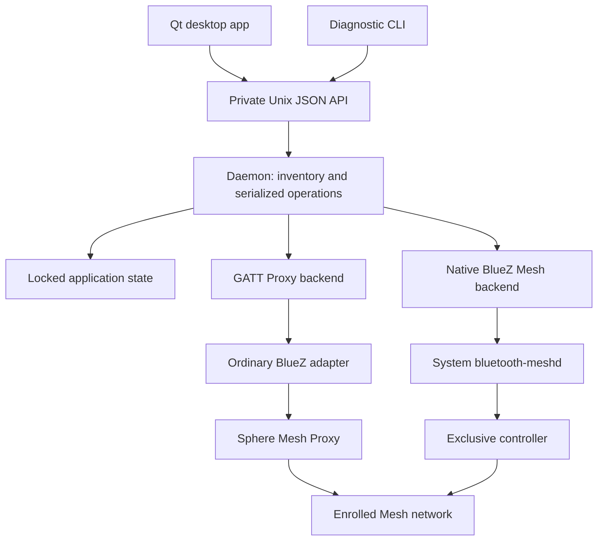

# Spherosphere technical report

Implementation report for version **0.2.1**, updated 2026-11-06.

This report describes the current software architecture, device
protocol, firmware findings, state ownership, operational modes,
and validation limits. The [project report](REPORT.md) explains
the investigation chronologically; the [user README](../README.md)
covers installation and everyday GUI use. The
[documentation index](README.md) routes to supporting evidence.
Commands using `./bin/`, `scripts/`, or `.venv` run from the
repository root; installed commands work outside the checkout.

## Reading guide

- [Project status](STATUS.md): current handoff, validation, and
  open work. Read this before resuming an investigation.
- [Project report](REPORT.md): the capture, provisioning,
  firmware, and application development story.
- [Bluetooth reference](PROTOCOL.md): message layouts,
  DP behavior, firmware findings, and evidence boundaries.
- [Desktop guide](GUIDE.md#views): GUI behavior and
  desktop integration.
- [Local service guide](GUIDE.md): daemon setup,
  API, profiles, state ownership, and recovery procedures.

## Contents

- [Architecture](#architecture)
- [Daemon profiles](#daemon-profiles)
- [Configuration and state](#configuration-and-state)
- [Local API contract](#local-api-contract)
- [Enrollment transaction and recovery](#enrollment-transaction-and-recovery)
- [Command-line operations](#command-line-operations)
- [Device protocol and firmware](#device-protocol-and-firmware-interpretation)
- [Desktop state and rendering](#desktop-state-and-rendering)
- [Reliability boundaries](#reliability-and-validation-boundaries)
- [Packaging and deployment](#packaging-and-deployment)
- [Development and research](#development-and-research)
- [Future work](#future-work)

## Architecture

### Responsibilities and ownership



Proxy and native Mesh are alternative active transports. The
diagram does not imply that both send from one identity at the
same time. Split mode adds ordinary scanning/GATT capacity to
the native arrangement; it does not create a third transport.

| Component | Responsibility |
|---|---|
| `daemon.py` | Network inventory, device runtimes, command serialization, reconnect supervision. |
| `api.py` / `client.py` | Private request/response interface and diagnostic CLI. |
| `transport.py` | Local adapter selection, scanning, and proxy connection lifecycle. |
| `bluez_mesh.py` | Native Mesh attachment and application-model D-Bus interfaces. |
| `enrollment.py` / `provision.py` | Candidate inspection, commissioning, configuration, and recovery. |
| `state.py` | Schema validation, process lock, durable keys, addresses, and sequence cursors. |
| `control.py` / `lighting.py` / `vendor.py` | Model-specific operations and response interpretation. |
| `gui/` | Qt state model, QML controls, and packaged preview assets. |
| `paths.py` / `user_service.py` | Shared paths, service profiles, and state migration. |

`spherosphered` owns application state and serializes Mesh
operations. The Qt/QML `spherosphere` application and
`spherospherectl` client use its private, versioned JSON Unix
socket. Neither client reads Mesh keys or opens Bluetooth.

One network can contain multiple named Sphere C devices.
Requests target a primary address or unique device name; with
multiple devices, untargeted device-control operations are
rejected. Names and addresses are stored together in the
private state database. The GUI's selector changes the target
and refreshes its scene, mode, power, brightness, and battery.

The service reconnects after transport failures. Its user
systemd unit restarts the daemon after process failure and
keeps logs in the journal. Enrollment discovers compatible
unprovisioned lamps, reports them immediately, then provisions
and configures them with automatically assigned names.

### Session and request lifecycle

A connection supervisor opens a backend session, publishes it
with an incremented generation, waits for its loss, closes it,
and reconnects with bounded exponential backoff. The default
backoff starts at one second and is capped at 30 seconds.
Successful reconnection creates a new generation; old
connection-scoped mode knowledge must not become fresh state
for that new session.

Each device runtime shares the network's command lock. This
serializes radio transactions across devices, not merely within
one Sphere. The runtime validates the target and requires an
available session before issuing a control operation. Health,
inventory, and effect-catalog queries do not require a successful
lighting transaction.

Target selection accepts a primary Mesh address or a unique
saved name. Composition data selects the actual server element
and supported standard models. A missing model yields an
unsupported operation rather than a speculative access message.
Names are display aliases; they never replace Mesh addressing
or cryptographic identity.

Connection loss, a timed-out radio operation, malformed device
data, and an unreachable local daemon are different failures.
The API and GUI keep these distinctions. Losing a reply does
not prove that a Set was never applied, so a reconnect does not
justify blindly replaying earlier UI actions.

## Daemon profiles

There are two transports and three recommended service profiles:

| Profile | Operation |
|---|---|
| `proxy` | Shared ordinary BlueZ adapter; GATT Mesh Proxy client. |
| `mesh` | Native Mesh member/relay with an exclusive controller. |
| `split` | Native Mesh controller plus a second ordinary adapter. |

Both `mesh` and `split` use `--mode mesh`. The ordinary adapter
selected by `--adapter MAC|hciN` is used for GATT discovery and
enrollment. It never selects the controller owned by system
`bluetooth-meshd`. Prefer a stable controller MAC over an index.

Proxy mode uses one GATT Proxy connection for the shared
network, with each enrolled node's DeviceKey available for its
configuration traffic. It does not make the host an advertising
relay. Native mode attaches to the host Mesh node through BlueZ
and can relay advertising-bearer packets.

The native host configures a 100-ms Network Transmit interval.
The generic backend uses legacy nonconnectable advertising,
whose minimum interval must be respected; treating radio timing
as merely an application polling preference caused earlier
transmit failures. Controller ownership and bearer timing are
part of the working setup, not properties of the GUI.

The tested native setup dedicates the motherboard controller
to system `bluetooth-meshd` with generic I/O and leaves ordinary
BlueZ on a USB adapter. Sharing one controller between ordinary
Bluetooth and Mesh exposed transmit/recovery failures; do not
present that arrangement as a supported third transport.
The [controller validation](TECH.md#shared-controller-bluez-findings)
and [issue notes](TECH.md#shared-controller-bluez-findings)
record the experiments and restoration requirements.

For ordinary GATT operation:

```sh
spherosphere-service install --profile proxy --enable-now
```

Native Mesh first requires the separately configured system
Mesh service and its dedicated controller. Then choose:

```sh
spherosphere-service install --profile mesh --enable-now
spherosphere-service install --profile split \
  --adapter USB_ADAPTER_MAC --enable-now
```

These are alternatives, not commands to run in sequence.
Mesh-mode enrollment is still an experimental opt-in via
`--experimental-enrollment`; split-controller enrollment has
worked on the development host, but general reliability and
normal-audio coexistence are not established. A controller
owned exclusively by Mesh cannot also provide ordinary GATT
scanning and enrollment. See the
[service setup guide](GUIDE.md#systemd-user-service)
for the complete controller and profile procedure.

## Configuration and state

| Purpose | Default |
|---|---|
| Config | `~/.config/spherosphere/daemon.toml` |
| Persistent Mesh state | `~/.local/state/spherosphere/state.json` |
| Socket | `$XDG_RUNTIME_DIR/spherosphere/control.sock` |

`XDG_CONFIG_HOME` and `XDG_STATE_HOME` select other roots.
Without an absolute `XDG_RUNTIME_DIR`, the socket falls back to
`runtime/control.sock` inside the Spherosphere state directory.
Empty or relative XDG values do not become working-directory
paths. No runtime default is inferred from the source checkout.

`src/spherosphere/paths.py` is shared by the daemon, clients,
provisioner, and service installer. The default TOML settings
can contain absolute `state` and `socket` paths as well as
`mode`, `adapter`, `experimental_enrollment`, `verbose`, and
`enroll_seconds`. All clients consult the same endpoint setting.

`SPHEROSPHERE_CONFIG`, `SPHEROSPHERE_STATE`, and
`SPHEROSPHERE_SOCKET` override shared defaults; explicit
command-line paths take precedence. A nondefault daemon
`--config` is not automatically known to other processes: give
clients the same `SPHEROSPHERE_CONFIG` or explicit socket.

The state contains NetKey, AppKey, DeviceKeys, addresses, IV
index, the GATT source's next sequence cursor, and device
metadata. An exclusive lock prevents concurrent owners.
Never delete, roll back, merge, or publish this file to fix a
connection problem. Sequence reuse with an existing identity
can reuse encryption nonces.

The native host's separate `bluez_mesh` record includes its
attachment identity. BlueZ owns that node's actual sequence and
receive replay state under `/var/lib/bluetooth/mesh`. Keep both
stores consistent; stop their owners before taking backups.
A GATT controller and native host use distinct source addresses
and sequence state.

To move an older checkout's state, first stop its owner:

```sh
spherosphere-service migrate-state /old/state/sphere_state.json
```

Migration locks both locations and moves the existing file.
It refuses a live owner, existing destination, or move across
filesystems. Alternatively, retain a custom file in place using
`--state PATH` when installing the service. See
[migration details](GUIDE.md#moving-an-older-installation).

### Persistence and trust boundaries

State saves write a temporary JSON file with mode 0600, flush
and synchronize it, replace the destination, and synchronize
the directory. An adjacent lock file holds an exclusive,
nonblocking process lock. Sequence advancement rejects values
below the current cursor and saves progress before subsequent
traffic can use the new allocation. This prevents ordinary
crash/restart from restoring a previously used send cursor; it
does not make restoring an old backup safe.

PB-GATT enrollment uses the application's provisioning context.
Its network sequence cursor is distinct from the native BlueZ
host's cursor. Native attachment reserves a separate address
and identity before use and retains BlueZ's attachment token.
Changing backend does not authorize either source to reuse the
other's address or security state.

The local API is protected by filesystem access, including a
mode 0600 socket. It is not a remote network service with its own
authentication system. Protect access to the user's files and
socket; a caller allowed to use that socket can operate the
enrolled lights. Inventory and normal diagnostics omit keys.
Raw phone/firmware evidence is outside the software's runtime
trust boundary and is not packaged or committed.

## Local API contract

Clients send newline-delimited JSON using API version 1. A
request names a method, supplies an object of parameters, and
includes a client request ID. Responses carry the same ID,
`ok`, and either a `result` or structured `error` object.

```json
{
  "version": 1,
  "id": 1,
  "method": "effect.get",
  "params": {"device": "ARI"}
}
```

The server limits messages to 64 KiB and bounds the wait for
an incoming request. It checks version, method, and parameter
shape before dispatch. Shutdown drains in-flight handlers
before the caller releases state ownership, and removes only
the socket instance created by that server. Startup refuses to
replace a regular file or an active listener at the socket path.

| Method family | Purpose |
|---|---|
| `health`, `status` | Connection state, generation, and composition-derived capabilities. |
| `device.list`, `device.rename`, `device.forget` | Inventory and local device metadata. |
| `enrollment.*` | Start, inspect, stop, or supply legacy named-enrollment input. |
| `control` | Primary power read/on/off/toggle operations. |
| `lighting` | Supported standard lighting model Gets and Sets. |
| `effect.*`, `vendor.read` | Guarded preset selection, catalog, and vendor status. |
| `countdown.*` | Guarded countdown read/set/cancel. |

Local request IDs correlate API replies; they are not Mesh
transaction IDs. Standard models can use their own TIDs, while
the inspected Tuya READ/DATA format has no such field. The
shared command lock and source/opcode filtering reduce response
mixing but do not turn an empty vendor acknowledgment into an
independent state observation.

Verification has four separate dimensions:

| API field | Established fact |
|---|---|
| `transport_acknowledged` | An expected response arrived. |
| `response_reported_value` | That response supplied a relevant value. |
| `independent_readback` | A separate Get/Read was performed. |
| `visually_verified` | A person checked the visible light during that operation. |

An independently issued read can still return partial data.
Check returned values, sources, and `missing_dp_ids`; do not
equate the existence of verification metadata with complete
confirmation. Automated API calls do not claim a visual check.
The [service guide](GUIDE.md) specifies the full
method parameters, result shapes, and error behavior.

## Enrollment transaction and recovery

Enrollment is a commissioning operation, not ordinary desktop
Bluetooth pairing. The physical green-blinking mode exposes
the unprovisioned device. The user first disables Bluetooth on
phones with Olight installed, powers on the Sphere, and rapidly
presses its button three times. The GUI then starts enrollment.
Those steps are in the [user guide](../README.md#enroll-a-sphere).

The scanner recognizes the observed Sphere C product identifier
and publishes a candidate immediately. Before provisioning, it
checks live services and the expected firmware 0.5 revision
record. A matching name or cached service list alone is not a
compatibility or pairing-state proof.

The enrollment window obtains exclusive network/radio access.
Proxy sessions yield their connection for commissioning; the
native enrollment path temporarily manages the host's radio
features. A discovery observer stays active through GATT
handoff so newly arriving candidates can still be shown. The
scanner is retained through connection rather than disconnecting
the very discovery object needed for that handoff.

The manager allocates a unique default name, retains recovery
material, and checkpoints ownership-sensitive state before
Provisioning Data is sent. Standard configuration binds the
matching models and sets network transmission parameters.
Compatible devices finish without pausing for user naming.

Failures before ownership transfer can be retried from fresh
discovery, with a bounded attempt count. Once provisioning may
have installed network data, recovery reuses the saved identity
and address allocation instead of starting a second identity.
Stopping a window prevents new attempts while allowing setup
already started to finish its safe boundary. UI states such as
found, checking, provisioning, retrying, recovering, complete,
and failed distinguish those stages.

Rename changes local metadata. Forget excludes the device from
active inventory; it is not a remote reset or key revocation.
There is no implemented unattended takeover of a Sphere that
is still enrolled in an unrelated network. Recommissioning
requires the user's physical pairing-mode action.

## Command-line operations

The GUI is the normal enrollment and control interface. The
CLI remains useful for diagnostics and repeatable experiments:

```sh
spherospherectl health
spherospherectl devices
spherospherectl --device ARI status
spherospherectl --device ARI control read
spherospherectl --device ARI lighting hsl
spherospherectl --device ARI effect get
spherospherectl --device ARI vendor-read 2 102
spherospherectl effect list
```

`effect get` obtains the selected preset and, when the complete
stock snapshot arrives, the current work mode. Firmware emits
bare mode followed by separate DPs 7, 101, 102, 103, and 104.
An isolated byte `01` is insufficient to distinguish mode1
from an acknowledgment. The collector confirms the full
ordered snapshot before decoding mode; it waits beyond the
first reply for the requested scene record.

Mutating examples, for a deliberately selected device:

```sh
spherospherectl --device ARI control on
spherospherectl --device ARI effect activate aurora
spherospherectl --device ARI countdown get
spherospherectl --device ARI countdown set 60
spherospherectl --device ARI countdown cancel
```

`effect set` and `effect select` are aliases for a DP102 write.
The captured firmware's DP102 handler selects color mode and
powers on; do not assume that writing a preset preserves a
previous mode. The existing `effect activate` API still performs
its legacy mode/write sequence; ordinary typed DP2 writes are
not an effective mode setter in the recovered dispatcher.

DP7 and DP101 share a firmware countdown. The public API limits
DP101 to 0..43200 seconds. A zero write was acknowledged and
read back; positive-duration expiry is not live-validated.
Firmware analysis indicates expiry toggles power, rather than
unconditionally turning it off. Do not rely on it as a tested
shutdown timer.

API results distinguish acknowledgment, a reported value,
independent readback, and visual verification. A cached value
is not independent device evidence. A timeout can leave the
result uncertain; do not automatically repeat a whole
multi-step activation.

The direct `spherosphere-provision` harness and research scripts
must not run against the daemon-owned state concurrently.
The [provisioning runbook](GUIDE.md#self-provisioning-and-direct-diagnostics),
[vendor guide](PROTOCOL.md#product-datapoints), and
[Bluetooth reference](PROTOCOL.md) retain low-level
vectors and validation boundaries.

## Device protocol and firmware interpretation

### Standard models and vendor framing

Power and ordinary lighting use standard Bluetooth Mesh
models, selected from authenticated composition data. Sphere C
advertises Generic OnOff, Lightness, CTL Temperature, and HSL
servers. HSL Hue/Saturation model IDs do not establish an xyL
server; unsupported models must remain unsupported in the API.
CTL protocol replies did not demonstrate a useful visible
temperature adjustment, so the GUI omits that control.

Olight-specific features use company 0x07d0, vendor server
model 0x0004. The device's vendor client model 0x0005 is not a
second arbitrary DP server. Application payload shapes are:

```text
READ         cc d0 07 CT COUNT ID...
DATA         cd d0 07 CT RECORD...
WRITE        c9 d0 07 CT RECORD...
WRITE_UNACK  ca d0 07 CT RECORD...
```

Records identify a DP, its type, and its encoded value. The
codec supports Boolean, enum, integer, raw/string, and bitmap
types; that encoding ability does not mean the product accepts
arbitrary writes. Public writes are deliberately narrower than
the schema and raw codec: visible DP102 selections, the legacy
DP2 activation step, and separately guarded DP101 countdowns.

In the captured firmware, the normal product READ callback
walks a fixed snapshot rather than selectively reading the
requested IDs. Its ordinary write dispatcher handles the first
DP record and returns. Multi-record encoding is therefore not
evidence that every record in a grouped request executes.
DP0/all-style SDK conventions are not a validated enumeration
method for this device.

The scene and mode collector described above is a response
interpreter, not a device modification. It retains received
message identities across bounded history eviction, filters
source/opcode, and gives a READ burst a collection budget after
its first response. Missing records remain missing at the
deadline. The observed 358–426-ms arrival of DP102 explains why
the former 100-ms settle returned incomplete state; it is not a
universal timing guarantee or a substitute for record validation.

### Captured image and reachable functions

The preserved update payload is 184,736 bytes and contains
readable Telink TC32 code and data. It is not a verified full
flash dump, an ARM image, or an identification of the exact
fitted MCU. Conclusions from its recovered handlers apply to
that captured build unless independently verified on hardware.

| DP | Captured-firmware behavior |
|---|---|
| 7 / 101 | Shared countdown; expiry toggles power. |
| 8 | Packed four-byte music state, gated by work mode. |
| 102 | Built-in preset selection, power-on, color-mode selection, and conditional button-slot update. |
| 103 | Battery report production. |
| 104 | Persistent sleep-policy setting. |
| 106 | Broad output/default restoration, including initial button-slot IDs. |
| 6 | No action in the traced ordinary DP dispatcher. |

Mode, internal rendering effect, and physical-button slot are
different state variables. Mapping 32 schema selector values
does not establish 32 distinct renderers; aliases exist. Preset
selection reaches slot/persistence logic, but exact app-level
button-slot updates still need controlled physical validation.

The internal color API bounds indices to 0..40 and uses two
41-entry buffers. Its coordinate table maps 41 logical pixels
onto an 11-by-5 canvas with padding. The manual's 41 colored and
67 white LEDs correct the earlier 64-RGB recollection. Virtual
coordinates do not establish physical ring/cap ordering or a
remote addressing scheme.

The identified FD50 protocol is a separate OTA path. Transfer
chunks reach an image-region flash writer, not a discovered
framebuffer uploader. Normal initialization clears optional
SDK command/getter hooks; the saved reference/store audit found
no registration for the sought custom-content route. This
bounds the negative result to identified paths in this image.

No custom frame, scene, or animation-program upload command is
validated. Generic APK scene compression does not supply a
working Sphere C feature by itself. The OTA writer's 192-KiB
limit leaves 11,872 bytes above this image, but boot acceptance,
integrity checks, alignment, total flash capacity, and usable
code-growth space remain unresolved. No modified image has
been flashed.

The [firmware ledger](FIRMWARE.md),
[handler audit](FIRMWARE.md#application-routing-and-dp-writes),
[pixel map](FIRMWARE.md#internal-pixels-and-virtual-coordinates), and
[Bluetooth reference](PROTOCOL.md) summarize behavior and confidence levels. The
[project report](REPORT.md) relates image analysis to the
control-software investigation.

## Desktop state and rendering

The Qt backend queues local socket requests and exposes state
to QML. Selecting a device clears the old display and unsent
device reads, then refreshes the new target. Generation/target
checks prevent late replies from the previous selection from
overwriting the new view. Enrollment management is separate
from ordinary lighting actions and disables conflicting UI
operations while commissioning is active.

Current work mode determines whether a remembered preset is
rendering. Mode0 uses Light; mode1 uses the selected preset or
Color Wheel. Modes2–4 have neutral previews and mode labels,
not a guessed animation. Scene and mode update together so a
refresh does not combine a new preset with an old mode. The
daemon stores last-known preview metadata per device; its
source remains distinguishable from fresh readback.

When selecting a Sphere, QML opens the relevant page, chooses
the pattern/animation category, and highlights the source.
That synchronization is limited to selection; background
refreshes do not continually take over manual navigation.
Power-off overrides the preview with black.

The color wheel uses HSV, while Mesh HSL messages use a
different lightness definition. For normalized HSV value V and
saturation S, the conversion uses `L = V * (1 - S / 2)` and
derives HSL saturation from V and L, with endpoint handling.
Returned values are converted back for display, not treated as
raw HSV. Device conversion/quantization can still change an
acknowledged tuple; individual model reports remain distinct.

The brightness knob has a logarithmic mapping to nonzero Mesh
levels; power is a separate operation. During an active preset
or Color Wheel mode, brightness uses the color path rather than
unconditionally reselecting the effect. The recorded preview
has its own display-gain mapping. Applying the physical curve
again to that preview would double-count its nonlinearity.
Gallery tiles stay at a fixed 50% display level; only the global
preview follows known device brightness.

Packaged WebP assets cover six patterns and 19 animations.
They are recordings under CC0, not executable effect definitions
or live device imagery. Camera focus, bloom, and calibration
limit fidelity. Original videos and manifests are private;
the shipped assets and their provenance are tracked separately.

## Reliability and validation boundaries

The two transports have different security implementations.
Native mode delegates network encryption, sequence persistence,
receive replay state, and relaying to BlueZ Mesh. The GATT
backend uses the pinned Python Mesh stack. Durable local send
state and receive duplicate suppression are not equivalent to
a complete standards-compliant receive replay list or full IV
Update participation in that Python stack.

The proxy stack's fixed-IV behavior and outbound segmented
transfer limitations remain distinct from successful small
control messages and inbound composition exchanges. Native
BlueZ ownership does not retroactively repair proxy-mode gaps.
The dependency's receive history and immediate-duplicate
suppression are bounded and not durable across process loss.
The pinned implementation sends outbound segments without a
complete selective-retransmission state machine. Check the
actual pinned source when changing those assumptions; success
with small access messages is not a segmented-transfer test.

Recorded hardware evidence establishes one-proxy multi-node
reads, dedicated native Mesh control, concurrent USB discovery,
and enrollment on the development split-controller setup. Relay
enabled is not a controlled proof of multi-hop forwarding
through the host. A discoverable USB radio is not a completed
headphone/audio coexistence test. General radio/controller and
enrollment compatibility remain broader validation work.

Static firmware evidence, simulated protocol tests, independent
reads, and visible lamp observations answer different questions.
Unimplemented areas include custom-scene upload, a finished
music feature, lockout UI, and a validated positive countdown
expiry. The original magnetic-charge Sphere remains a separate
unvalidated device generation.

### Shared-controller BlueZ findings

The failed shared-controller trials used Debian BlueZ and
bluez-meshd 5.87-5, libell 0.83-1, kernel 7.2.12+deb14-amd64,
and an Intel controller with USB ID 8087:0025. Ordinary
`bluetoothd` and auto-selected Mesh MGMT I/O shared that
controller. These are recorded experiment versions, not a
claim about all current BlueZ releases or controllers.

Two failure signatures were preserved separately:

1. D-Bus and MGMT accepted Mesh sends, but HCI rejected
   `LE Set Extended Advertising Parameters` (`0x2036`) with
   Command Disallowed (`0x0c`) for advertising handle 7. The
   kernel logged failure `-16`, and no matching data send
   followed. Random-address command `0x2005` failures and
   stuck discovery were also observed. Resets sometimes
   restored traffic temporarily, without establishing a fix.
2. `bluetooth-meshd` aborted with a detected double free.
   Matching debug data placed the detected free in
   `send_queued`, reached through `request_complete` and
   `can_read_data`. A packet-lifetime hypothesis involves a
   queued object being reused before an earlier asynchronous
   callback completes. This is not yet a deterministic
   reproducer or proof of the first incorrect free.

The recorded executable build ID is
`5e9c40ce4eb4f7d36a142ee89a3711bc90f72442`.
Executable-relative return addresses were `0x9b7f`, `0x3d004`,
and `0x3d531`, respectively. These offsets identify that binary,
not arbitrary BlueZ installations. Advertising handle numbers
also do not directly state concurrent-set capacity; capacity
exhaustion was not established as the cause.

The dedicated generic-I/O setup subsequently passed control
and a 90-second status run. Its first 10-ms legacy advertising
interval was invalid; a 100-ms interval resolved that specific
failure. It did not diagnose or repair the MGMT lifetime
issue. Concurrent USB discovery passed, and split-controller
enrollment later succeeded, while ordinary audio and controlled
multi-hop reachability remain unverified.

#### Reproduction and upstream follow-up

A useful reproduction must correlate four things: accepted
local requests, actual HCI setup/data transmission, remote
Mesh replies, and the meshd journal. In the recorded sequence,
an otherwise working shared-controller setup stopped responding
after ordinary GATT discovery/connection and enrollment
handoffs; later pure advertising probes could also fail.
No minimal deterministic sequence was isolated.

Related upstream references examined during the investigation
were [BlueZ 1950](https://github.com/bluez/bluez/issues/1950),
[2337](https://github.com/bluez/bluez/issues/2337),
[2353](https://github.com/bluez/bluez/issues/2353), and
[PR 2527](https://github.com/bluez/bluez/pull/2527). They describe
related scan/address/generic-I/O behavior, not one established
root cause for the recorded MGMT crash. Recheck applicability
and merge/release status before preparing an upstream report.
The [MGMT I/O source](https://github.com/bluez/bluez/blob/master/mesh/mesh-io-mgmt.c)
is the ownership-audit entry point.

Complete journals, traces, matching executable/debug data, and
manifests remain in ignored local evidence storage. Publish
only sanitized trace excerpts and a symbolicated stack; never
attach Mesh databases, keys, tokens, unrelated-device traffic,
or raw cores. No upstream bug report has been submitted by this
project. Separate HCI state-transition and packet-lifetime
questions until evidence establishes a link.

## Packaging and deployment

The distribution is `spherosphere`; the Python import package
has the same name. `pyproject.toml` defines the app, daemon,
maintenance, and research entry points. GUI dependencies are an
optional extra, so service-only environments need not install
Qt. Wheels include QML, recorded assets, the icon/desktop entry,
systemd template, and profile/controller helper assets.

A non-editable installation can run without the checkout. The
desktop launcher and user service should reference that stable
installation. Updating an editable development tree does not
automatically replace a separate installed wheel. The source
version and running deployment version must be checked
independently during a release.

`spherosphere-service` installs the selected profile, writes the
shared config and unit override, and records custom paths for
later profile changes. Its normal operation does not configure
the privileged system Mesh controller service. That separate
helper resolves the chosen hardware address and hands the
controller to `bluetooth-meshd`; the daemon does not quietly
take over a desktop Bluetooth radio.

Desktop assets installed inside a virtual environment are not
automatically registered in the user's application menu.
Register them in XDG data locations or use a distribution
package; see [desktop integration](GUIDE.md#desktop-integration).
The library code, runtime state, local socket, system Mesh
store, and raw research artifacts have separate lifecycles.

## Development and research

For an editable development environment:

```sh
python3 -m venv .venv
./.venv/bin/python -m pip install -e '.[dev,gui]'
./.venv/bin/pytest -q
```

The 0.2.1 source passed 501 tests. GUI/local-API tests need
permission to create temporary Unix sockets. A restricted
sandbox can reject socket creation without a source regression.
Unit and simulated tests do not replace live radio validation.

Bluetooth transport uses the exact `btmesh` revision declared
in `pyproject.toml`: `a8f7bbbebaeba124d7d08cb16122055074f2ef46`
from the MIT-licensed
[ha-bluetooth-mesh](https://github.com/dasimon135/ha-bluetooth-mesh)
repository, corresponding to the inspected 0.10.3 code. A full
commit rather than a moving branch makes the tested dependency
reproducible. No claim about today's package-index versions is
needed to install that pin.

Earlier compatibility changes are explicit first-party code:
`transport.py` selects characteristics within the intended
Mesh service, handles stale discovery data, and preserves the
scan-to-connect handoff. `access.py` supplies Config Network
Transmit messages absent from that upstream revision. The
dependency is not an undocumented patched or vendored copy.

The original capture analyzer, scanner,
firmware revision reader, and targeted probes remain available:

```sh
./.venv/bin/python -m spherosphere.capture --no-pdus
./.venv/bin/python scripts/scan_mesh.py --seconds 10
```

- `src/spherosphere/`: daemon, clients, access codecs, state,
  transports, and GUI assets.
- `bin/`: development launchers and the Bluetooth lab helper.
- `scripts/`: inspection and diagnostic tools.
- `tests/`: codecs, service lifecycle, transport, GUI, and
  packaging checks.
- `packaging/`: desktop assets, systemd unit, and profiles.
- `state/`: ignored research captures and logs from development;
  it is no longer the default live Mesh state directory.
- `old/`: optional private `spherosphere-internals` submodule
  for research, recovered source and LFS artifact snapshots.
  Access requires permission to the private repository; public
  installs and CI do not require this checkout.

Keep key-bearing state, phone exports, firmware images, raw
captures, and original videos out of the public repository.
Private archival artifacts are retained in the internals
repository's LFS snapshots. Live device state stays outside
both repositories. Recorded preview
assets are separately licensed and tracked; see
[asset provenance](../packaging/desktop/ASSETS.md).

## Future work

The project priorities are music mode, secure remote control,
then custom firmware content, in that order. These are roadmap
items; no music streaming, Internet REST endpoint, or custom
scene-upload feature is implemented in the current release.

### 1. Understand and implement music mode

The captured firmware has a four-byte DP8 handler gated by
work mode 3, but SDK field names do not establish its visible
behavior. Ordinary typed DP2 writes are ineffective in the
traced dispatcher, and a nonzero first color field selects a
pseudorandom value. Begin by validating mode transitions,
payload interpretation, and actual light output on the device.
The [music protocol section](PROTOCOL.md#music-dp-8) and
[firmware handler](FIRMWARE.md#application-routing-and-dp-writes)
record the current evidence.

Implementation then needs an audio-input and feature-extraction
path, a bounded update cadence suitable for Mesh, start/stop
and reconnect behavior, and GUI controls. Microphone ownership,
audio processing, and supported client/source choices remain
design questions; the roadmap does not assume the light itself
provides an audio-input stream.

### 2. Provide a secure Internet-accessible REST API

An Android app or another remote client should be able to
operate the daemon without becoming a Mesh key holder. A REST
interface should reuse the existing target validation, command
serialization, state ownership, and verification semantics.
The existing Unix JSON API remains a local interface; it has
filesystem protection rather than Internet authentication.

Remote access requires encrypted transport, authenticated
clients, explicit authorization for controls and management
operations, credential provisioning/revocation, and bounded
request and streaming rates. Mesh secrets stay on the host.
Do not expose the current local interface as an anonymous HTTP
proxy. Whether HTTP terminates in the daemon or a companion
gateway, and which authentication/deployment model to support,
are design decisions still to make.

### 3. Enable custom scenes and animations in firmware

The stock image has an internal 41-pixel engine, but no validated
external upload path. The intended direction is modified
firmware with a supported scene/animation upload interface,
rather than merely replacing one built-in effect in an image.
The scene DP is a candidate interface, not an implemented
contract or a proven stock-firmware feature.

This work needs a defined content format and playback timing,
transfer validation and size limits, storage/persistence rules,
and matching daemon/app support. Flash layout, integrity and
boot acceptance, safe update/recovery, and physical pixel
mapping must be established before treating a patch as usable.
The [firmware report](FIRMWARE.md#upload-path-conclusion-and-remaining-questions)
contains the present boundaries. No modified image has been
flashed, and a roadmap entry does not itself begin a live OTA
experiment.
